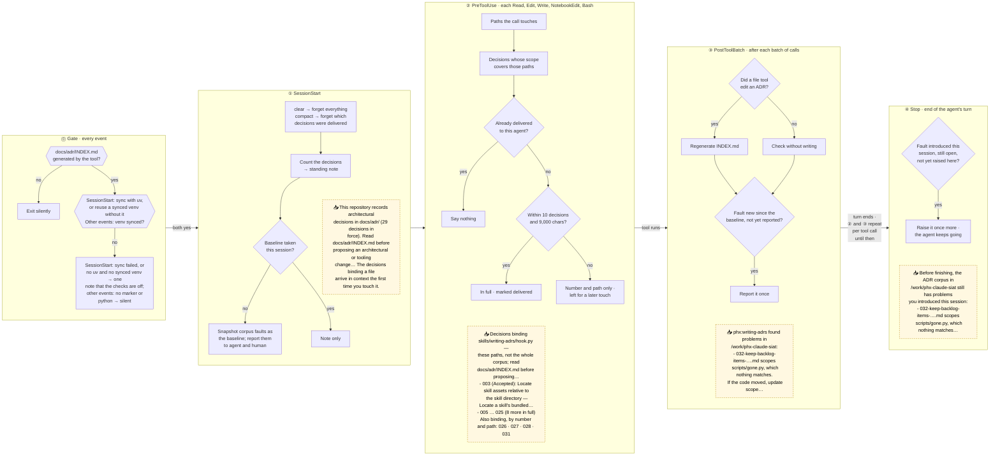

# How the writing-adrs hooks shape a session

The `phx` plugin declares Claude Code hooks ([`hooks/hooks.json`](../hooks/hooks.json))
that run [`skills/writing-adrs/hook.py`](../skills/writing-adrs/hook.py) on six events.
In a repository that records architectural decisions (ADRs) under `docs/adr/`, the hooks
do two jobs:

- **Deliver the decisions that govern a file** the first time the agent touches it, so the
  agent doesn't relitigate a settled choice it never saw ([ADR 025](adr/025-deliver-binding-decisions-by-hook-at-first-touch.md)).
- **Report faults in the decision records once**, rather than on every turn until they're
  fixed ([ADR 026](adr/026-report-findings-by-delta-from-a-session-baseline.md)).

This page assumes you know Claude Code hooks and their events. It assumes nothing about
the plugin.

## Terms

- **Scope.** The paths an ADR's frontmatter says it governs. Each entry is an exact file,
  or a directory ending in `/` that covers everything beneath it.
- **Binding.** A decision binds a path when its scope covers that path.
- **Managed root.** A directory whose `docs/adr/INDEX.md` opens with the tool's generated
  header. Everywhere else, the hooks do nothing.
- **Fault.** Something wrong in the corpus. Examples include a scope entry that names a
  path that no longer exists, a malformed ADR, two ADRs that share a number, a gap in the
  numbering, a heading whose number disagrees with its filename, a stray file in
  `docs/adr/`, and a stale index.
- **Baseline.** The faults already present when the session started.
- **Session state.** One small JSON file per session, under the plugin's data directory.
  It holds the baseline, the faults already reported, and the decisions already shown to
  each agent, whether that agent is the main thread or a subagent.

## The flow

Stages run left to right through a session. ② and ③ repeat for every tool call until the
agent's turn ends. The dashed yellow boxes show what the agent receives at each stage.
They come from a real run against this repository, shortened. The full text is in the next
section.



**Subagents** get the ① standing note at `SubagentStart` and nothing else from that stage,
because they share the session's baseline. ② tracks deliveries per agent, so a subagent
receives a decision on its own first touch even when the main thread already has it.
`SubagentStop` runs the ④ check for the subagent.

## What the agent sees, step by step

These steps come from a recorded session in this repository, with 29 decisions in force.
Each block is the `additionalContext` the hook returned, verbatim except for two changes.
Elisions are marked `[…]`, and the checkout path shows as `/work/phx-claude-siat`. Claude
Code wraps each block in a system reminder, and none appears as a chat message.

### 1. The session starts

This arrives before the first prompt:

```text
This repository records architectural decisions in docs/adr/ (29 decisions in force).
Read docs/adr/INDEX.md before proposing an architectural or tooling change, so a settled
decision is not relitigated. The decisions binding a file arrive in context the first
time you touch it. Record a new decision with the phx:writing-adrs skill.
```

The corpus has no faults, so the hook says nothing else and the human sees nothing.

### 2. The agent reads `skills/writing-adrs/hook.py`

Fourteen decisions bind this file, more than the ten that one touch shows. This arrives
next to the `Read` result:

```text
Decisions binding skills/writing-adrs/hook.py — these paths, not the whole corpus; read
docs/adr/INDEX.md before proposing an architectural or tooling change:
- 003 (Accepted): Locate skill assets relative to the skill directory — Locate a skill's
  bundled files relative to the skill's own directory, not via a hook-written plugin root
  pointer. [docs/adr/003-locate-skill-assets-relative-to-skill-directory.md]
- 005 (Accepted): Mirror each skill's declared tooling as a pull-request check — […]
[… 8 more rows: 013, 014, 017, 018, 022, 023, 024, 025 …]
Also binding, by number and path: 026 [docs/adr/026-report-findings-by-delta-from-a-session-baseline.md];
027 [docs/adr/027-anchor-a-script-to-the-tree-it-acts-on.md]; 028 […]; 031 […]
```

Each row gives the decision's number, status, title, one-line summary, the condition that
would reopen it (`Revisit when: …`, where it has one), and its file. The hook records
only the ten rows shown in full as delivered.

### 3. The agent reads the same file again

This arrives next to the second `Read` result. The four decisions named only by number now
arrive in full:

```text
Decisions binding skills/writing-adrs/hook.py — these paths, not the whole corpus; read
docs/adr/INDEX.md before proposing an architectural or tooling change:
- 026 (Accepted): Report findings by delta from a session baseline — […]
- 027 (Accepted): Anchor a script to the tree it acts on — […]
- 028 (Accepted): Admit ambient project instructions as an archival defence — […]
- 031 (Accepted): Adopt a uv workspace at the repository root — […]
```

From here on, none of these fourteen arrive again for the main thread, whatever path it
touches:

- `Read pyproject.toml` (bound only by 031, already delivered): no context.
- `Bash: uv run --directory skills/writing-adrs pytest -q`: no context. A path named in a
  shell command counts as touched, but everything that binds `skills/writing-adrs/` has
  already arrived.

### 4. A subagent starts and reads `pyproject.toml`

The subagent receives the standing note from step 1, then its own copy of 031, which the
main thread already holds:

```text
Decisions binding pyproject.toml — these paths, not the whole corpus; read
docs/adr/INDEX.md before proposing an architectural or tooling change:
- 031 (Accepted): Adopt a uv workspace at the repository root — Restructure the
  repository as a uv workspace with a root pyproject.toml and one shared uv.lock, […]
  Revisit when: A workspace member needs a dependency version the shared resolution cannot
  satisfy for every member at once. [docs/adr/031-adopt-a-uv-workspace-at-the-repository-root.md]
```

### 5. The agent edits an ADR and leaves a fault

Using the `Edit` tool, the agent adds `scripts/gone.py`, which doesn't exist, to ADR 032's
scope. After the batch, the hook regenerates `INDEX.md` and reports the new fault next to
the `Edit` result:

```text
phx:writing-adrs found problems in /work/phx-claude-siat:
- 032-keep-backlog-items-as-plain-markdown-not-frontmatter.md scopes `scripts/gone.py`,
  which nothing matches. If the code moved, update `scope`; if it is gone, ask whether the
  decision still binds anything, and revisit it
```

Later batches say nothing more about the fault, because the hook has already reported it.

### 6. The agent tries to end its turn with the fault still open

This arrives at the end of the turn, labelled `Stop hook feedback` in the transcript. The
hook returns it as `additionalContext`, not `decision: "block"`, and Claude Code continues
the turn so the agent can act on it:

```text
Before finishing, the ADR corpus in /work/phx-claude-siat still has problems you
introduced this session:
- 032-keep-backlog-items-as-plain-markdown-not-frontmatter.md scopes `scripts/gone.py`,
  which nothing matches. […]
```

This happens once. If the agent stops again with the fault unfixed, the hook says nothing
more and the turn ends.

### 7. A new session starts with that fault in place

The fault becomes part of the new session's baseline. The hook reports it once, to the
agent before the first prompt and to the human as a visible message (`systemMessage`). It
never reports the fault again in that session:

```text
This repository records architectural decisions in docs/adr/ (28 decisions in force). […]

phx:writing-adrs found problems in /work/phx-claude-siat:
- 032-keep-backlog-items-as-plain-markdown-not-frontmatter.md scopes `scripts/gone.py`,
  which nothing matches. […]
```

The count drops to 28 because a decision with a fault is left out of the count and out of
`INDEX.md` until it's fixed. A scope fault like this one still lets the decision bind its
other paths, so the decision still arrives on first touch. A malformed ADR binds nothing
until it's fixed. Of two ADRs that share a number, the one whose filename sorts second
binds nothing.

## Edge cases

- **Resuming** (`resume`) continues the same session, so nothing is delivered or reported
  twice. **Forking** (`fork`) runs `SessionStart` again, but whether the fork carries its
  parent's session id, and with it the parent's deliveries, is unverified
  ([backlog item: verify the ADR hook on a forked session](backlog/verify-the-adr-hook-on-a-forked-session.md)).
- **Compaction** (`SessionStart` with `compact`) forgets which decisions were delivered,
  because the compacted context may no longer hold them. Each decision arrives again on its
  next touch. The baseline and the reported faults survive. **`/clear`** forgets
  everything.
- **Size.** One touch carries at most ten decisions in full and stays under 9,000
  characters, inside Claude Code's 10,000-character cap. A decision that doesn't fit is
  named by number and path, and delivered in full on a later touch.
- **What counts as a touch.** `Read`, `Edit`, `Write`, and `NotebookEdit` touch their file
  path. `Bash` touches every token in the command that names an existing path, and any file
  a redirect is about to create. `Grep`, `Glob`, and `@`-mentioned files deliver nothing.
- **Shell edits to an ADR** don't count as the agent's own ADR edit, so `INDEX.md` isn't
  regenerated. The hook reports the stale index as a fault instead.
- **The hooks never refuse anything.** Every hook exits 0 and returns context only, so no
  tool call or prompt is ever denied. Step 6's one continuation is the only time the hooks
  change what the agent does next.
- **A crashing hook** reports the error once per session as context, then stays silent.
- **No `uv`.** If an earlier session already synced this plugin version's environment,
  every hook runs from it as usual, `SessionStart` included. Only a plugin update needs uv
  again. With no synced environment, `SessionStart` says once that the ADR checks are off
  until uv is installed, and every other event stays silent.
- **Offline first session.** The first session after a plugin update syncs the tool's
  environment, which needs network access. If the sync fails, `SessionStart` says once
  that it could not build the environment, and every other event stays silent. The next
  session with network access syncs it. The same note, which names these causes as
  examples, appears in two other cases. The first is a Claude Code that sets no
  `CLAUDE_PLUGIN_DATA`, which leaves the sync nowhere to build. The second is a checkout
  loaded with `--plugin-dir` whose `UV_PROJECT_ENVIRONMENT` names a path with a `..`
  component, the checkout itself, or a place outside the checkout. The sync refuses that
  path, as the README's local development section explains.
- **Interrupted sync.** The environment is marked complete only after a successful sync.
  A first build cut short therefore leaves no marker, and every event stays silent, with
  no note. The likeliest causes are a kill, or the 120 s `SessionStart` timeout on a slow
  first build. Each plugin version has one environment that every session shares, so an
  interrupted build silences every open session that uses it. A later `SessionStart`
  re-syncs with the marker left in place, because a version's lock never changes, and a
  failed sync removes the marker. A checkout's lock can change, so a checkout's own venv
  is unmarked for the whole re-sync instead. The next `SessionStart` completes an
  unfinished build. So does any of the skill's own `adr.sh` commands, which rebuild the
  environment where the marker is missing.
- **Parallel calls** share the state file under a lock. A call that can't get the lock
  within about a second says nothing rather than delay the tool.
- **Old state files** are pruned after 30 days, at session start.
